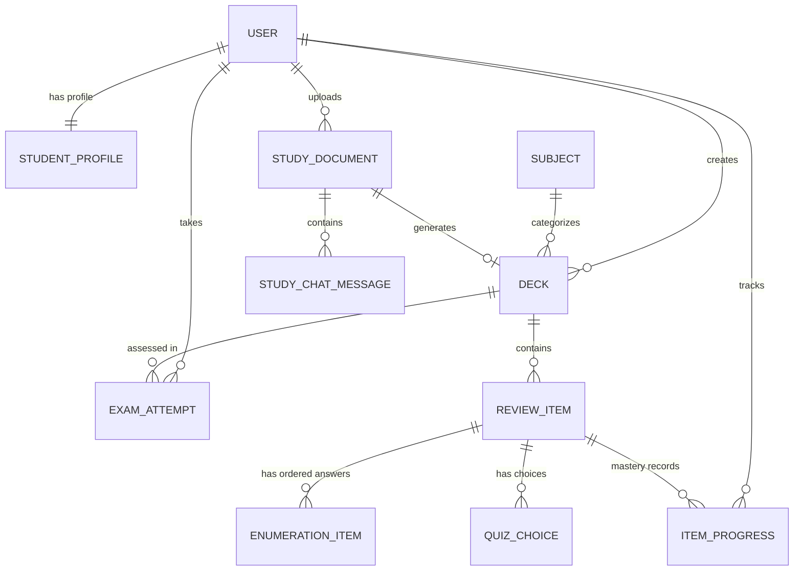

# TUPAS Reviewer — Official Documentation

> **Project:** TUPAS Reviewer (Django 5.2)
> **Scope:** Student registration, deck library, multi-modal review (Flip Card, Smart Highlighter, Enumeration Drill), an Exam Simulator with saved scores, and the TUPAS Study Buddy PDF/notes tutor.
> **Database:** 11 logical tables — Django's built-in `User` plus 10 application models in `tupas/models.py` (8 core models + 2 Study Buddy models).

---

## 1. Project Overview

TUPAS is a study/reviewer platform for students. Students register with their demographic and academic details, browse reviewer decks, practise using four different review modes, track mastery per item, and take auto-graded exams with saved score history.

### Core capabilities

1. **Student registration and login** — captures school, course/strand, year level, region, province, and city/municipality.
2. **Student dashboard / deck library** — highlights decks recommended for the student's `course_or_strand`.
3. **Deck overview** — shows item counts per review mode and the student's progress.
4. **AI Auto-Reviewer Generator** — converts pasted notes into flip cards, highlight notes, and enumeration drills using Groq, Google Gemini, or OpenRouter, then saves them to a deck.
5. **TUPAS Study Buddy** — upload a PDF or paste notes, chat with the handout (summaries, Taglish explanations, key terms, quizzes), and convert it into an owned reviewer deck in one click.
6. **Four review modes**
   - 🃏 **Flip Card Mode** — 3D CSS flip cards with "Got It" / "Study Again" mastery tracking.
   - 🖍️ **Smart Highlighter Mode** — `[[keyword]]` markers rendered as yellow highlights, with a toggle that hides them as tap-to-reveal blanks.
   - 📋 **Enumeration Drill Mode** — reveal answers or type them; supports strict order or any order.
   - 📝 **Exam Simulator Mode** — multiple choice, identification, enumeration, or mixed; auto-graded and saved to `ExamAttempt`.
7. **Installable PWA** — web app manifest, home-screen icons, service worker, offline fallback, and a native install prompt on supported browsers.

---

## 2. Tech Stack

| Layer | Technology |
|---|---|
| Framework | Django 5.2.19 |
| Language | Python |
| Database | SQLite (development) |
| Frontend | Bootstrap 5, Bootstrap Icons, vanilla JavaScript, CSS 3D transforms |
| Auth | Django `django.contrib.auth` (built-in `User`) |
| Admin | Django admin with inline editors and demographic filters |
| AI | Groq (`llama-3.3-70b-versatile`), Google Gemini (`gemini-2.5-flash`), or OpenRouter (`google/gemma-4-31b-it:free`), configurable |
| PWA | Web app manifest, root-scope service worker, Cache Storage, install prompt, offline page |

---

## 3. Entity Relationship Diagram



### Logical table map

| # | Logical table | Django model | Physical table (default) |
|---|---|---|---|
| 1 | `users` | `django.contrib.auth.models.User` | `auth_user` |
| 2 | `student_profiles` | `StudentProfile` | `tupas_studentprofile` |
| 3 | `subjects` | `Subject` | `tupas_subject` |
| 4 | `decks` | `Deck` | `tupas_deck` |
| 5 | `review_items` | `ReviewItem` | `tupas_reviewitem` |
| 6 | `enumeration_items` | `EnumerationItem` | `tupas_enumerationitem` |
| 7 | `quiz_choices` | `QuizChoice` | `tupas_quizchoice` |
| 8 | `item_progress` | `ItemProgress` | `tupas_itemprogress` |
| 9 | `exam_attempts` | `ExamAttempt` | `tupas_examattempt` |
| 10 | `study_documents` | `StudyDocument` | `tupas_studydocument` |
| 11 | `study_chat_messages` | `StudyChatMessage` | `tupas_studychatmessage` |

> **Note:** Table 1 is Django's built-in authentication table. Its physical name is `auth_user`; logically it is the project's `users` table. The ten custom models are defined in `tupas/models.py`, and the Study Buddy pair is added by migration `0002_studydocument_studychatmessage`.

---

## 4. The 11-Table Specification

### Table 1 — `User` (Django built-in)

**Model:** `django.contrib.auth.models.User`
**Purpose:** Authentication and ownership of student records.

| Field | Type | Notes |
|---|---|---|
| `id` | BigAutoField | Primary key |
| `username` | CharField(150) | Unique, required |
| `password` | CharField(128) | Hashed password |
| `email` | EmailField | Captured at registration |
| `first_name`, `last_name` | CharField(150) | Optional Django fields |
| `is_staff`, `is_active`, `is_superuser` | BooleanField | Django auth flags |
| `date_joined`, `last_login` | DateTimeField | Django auth timestamps |

Relationships:
- One-to-one with `StudentProfile` (`related_name='profile'`).
- One-to-many with `Deck.created_by`, `ItemProgress.user`, and `ExamAttempt.user`.

---

### Table 2 — `StudentProfile`

**Purpose:** Student demographic and academic information.
**Relationship:** One-to-one with `User` (`related_name='profile'`).

| Field | Type | Constraints / Notes |
|---|---|---|
| `user` | OneToOneField → `User` | `on_delete=CASCADE`, `related_name='profile'` |
| `full_name` | CharField(200) | Required |
| `birthdate` | DateField | `null=True`, `blank=True` |
| `region` | CharField(100) | Required |
| `province` | CharField(100) | Required |
| `city_municipality` | CharField(100) | Required |
| `school_name` | CharField(200) | Required |
| `student_level` | CharField(50) | Choices: `JHS`, `SHS`, `COLLEGE`, `BOARD` |
| `course_or_strand` | CharField(150) | Required; used for deck recommendations |
| `year_level` | CharField(50) | Required |

---

### Table 3 — `Subject`

**Purpose:** Course/category grouping for decks.

| Field | Type | Constraints / Notes |
|---|---|---|
| `subject_name` | CharField(150) | Required |
| `target_course` | CharField(150) | `blank=True` |
| `description` | TextField | `blank=True` |

Relationship:
- One-to-many with `Deck` (`related_name='decks'`).

---

### Table 4 — `Deck`

**Purpose:** A reviewer set belonging to a subject.

| Field | Type | Constraints / Notes |
|---|---|---|
| `subject` | ForeignKey → `Subject` | `on_delete=CASCADE`, `related_name='decks'` |
| `title` | CharField(200) | Required |
| `description` | TextField | `blank=True` |
| `created_by` | ForeignKey → `User` | `null=True`, `blank=True`, `on_delete=SET_NULL` |
| `created_at` | DateTimeField | `auto_now_add=True` |

Relationships:
- One-to-many with `ReviewItem` (`related_name='items'`).
- One-to-many with `ExamAttempt` (`related_name='exam_attempts'`).

---

### Table 5 — `ReviewItem`

**Purpose:** Core multi-modal review row. One row can act as a flip card, a highlight note, or an enumeration prompt.

| Field | Type | Constraints / Notes |
|---|---|---|
| `deck` | ForeignKey → `Deck` | `on_delete=CASCADE`, `related_name='items'` |
| `item_type` | CharField(30) | Choices: `FLIP_CARD`, `HIGHLIGHT_NOTE`, `ENUMERATION`; default `FLIP_CARD` |
| `prompt_text` | TextField | Front question (Flip Card), paragraph with `[[keywords]]` (Highlight Note), or list prompt (Enumeration) |
| `main_answer` | CharField(255) | `blank=True`, `null=True`; back answer for Flip Card / Identification |
| `explanation` | TextField | `blank=True` |
| `is_strict_order` | BooleanField | `default=False`; used when `item_type == 'ENUMERATION'` |

Relationships:
- One-to-many with `EnumerationItem` (`related_name='enum_answers'`).
- One-to-many with `QuizChoice` (`related_name='choices'`).
- One-to-many with `ItemProgress` (`related_name='progress_records'`).

---

### Table 6 — `EnumerationItem`

**Purpose:** Ordered or unordered accepted answers for an enumeration `ReviewItem`.

| Field | Type | Constraints / Notes |
|---|---|---|
| `review_item` | ForeignKey → `ReviewItem` | `on_delete=CASCADE`, `related_name='enum_answers'` |
| `answer_text` | CharField(255) | Required |
| `order_number` | PositiveIntegerField | `default=1`; used when the parent item is strict-order |

Ordering: `order_number`, then `id`.

---

### Table 7 — `QuizChoice`

**Purpose:** Multiple-choice options for Exam Simulator mode.

| Field | Type | Constraints / Notes |
|---|---|---|
| `review_item` | ForeignKey → `ReviewItem` | `on_delete=CASCADE`, `related_name='choices'` |
| `choice_text` | CharField(255) | Required |
| `is_correct` | BooleanField | `default=False` |

Rule: exactly one correct choice per multiple-choice question is recommended.

---

### Table 8 — `ItemProgress`

**Purpose:** Per-student mastery tracker.
**Constraint:** `unique_together = ('user', 'review_item')`.

| Field | Type | Constraints / Notes |
|---|---|---|
| `user` | ForeignKey → `User` | `on_delete=CASCADE` |
| `review_item` | ForeignKey → `ReviewItem` | `on_delete=CASCADE`, `related_name='progress_records'` |
| `mastery_status` | CharField(20) | Choices: `MASTERED` ("Got It"), `NEEDS_REVIEW` ("Study Again") |
| `last_reviewed` | DateTimeField | `auto_now=True` |

---

### Table 9 — `ExamAttempt`

**Purpose:** Quiz scores and history.

| Field | Type | Constraints / Notes |
|---|---|---|
| `user` | ForeignKey → `User` | `on_delete=CASCADE`, `related_name='exam_attempts'` |
| `deck` | ForeignKey → `Deck` | `on_delete=CASCADE`, `related_name='exam_attempts'` |
| `exam_mode` | CharField(50) | Choices: `MULTIPLE_CHOICE`, `IDENTIFICATION`, `ENUMERATION`, `MIXED` |
| `score` | IntegerField | Number of correct items |
| `total_items` | IntegerField | Number of graded items |
| `percentage` | DecimalField(5, 2) | `score / total_items × 100`, stored to 2 decimals |
| `date_taken` | DateTimeField | `auto_now_add=True` |

Ordering: newest attempts first.

---

### Table 10 — `StudyDocument`

**Purpose:** One uploaded or pasted handout per row for the TUPAS Study Buddy.
**Relationship:** Many-to-one with `User` (`related_name='documents'`); optional many-to-one with `Deck` (`related_name='source_documents'`).

| Field | Type | Constraints / Notes |
|---|---|---|
| `user` | ForeignKey → `User` | `on_delete=CASCADE`, `related_name='documents'` |
| `title` | CharField(200) | Required |
| `pdf_file` | FileField | `upload_to='study_pdfs/'`, `null=True`, `blank=True` |
| `extracted_text` | TextField | `blank=True`; source text for the tutor and generator |
| `page_count` | PositiveIntegerField | `default=1` |
| `generated_deck` | ForeignKey → `Deck` | `null=True`, `blank=True`, `on_delete=SET_NULL`, `related_name='source_documents'` |
| `created_at` | DateTimeField | `auto_now_add=True` |

Ordering: newest first. `word_count` is a derived property.

---

### Table 11 — `StudyChatMessage`

**Purpose:** Ordered chat transcript between the student and the TUPAS Study Buddy for one handout.

| Field | Type | Constraints / Notes |
|---|---|---|
| `document` | ForeignKey → `StudyDocument` | `on_delete=CASCADE`, `related_name='messages'` |
| `sender` | CharField(20) | Choices: `STUDENT`, `TUPAS` |
| `message` | TextField | Required |
| `created_at` | DateTimeField | `auto_now_add=True` |

Ordering: oldest first, so the transcript reads top to bottom.

---

## 5. Relationships Summary

| Parent | Child | Type | `related_name` |
|---|---|---|---|
| `User` | `StudentProfile` | One-to-one | `profile` |
| `User` | `Deck` | One-to-many | `decks_created` |
| `User` | `ItemProgress` | One-to-many | `item_progress` |
| `User` | `ExamAttempt` | One-to-many | `exam_attempts` |
| `Subject` | `Deck` | One-to-many | `decks` |
| `Deck` | `ReviewItem` | One-to-many | `items` |
| `Deck` | `ExamAttempt` | One-to-many | `exam_attempts` |
| `ReviewItem` | `EnumerationItem` | One-to-many | `enum_answers` |
| `ReviewItem` | `QuizChoice` | One-to-many | `choices` |
| `ReviewItem` | `ItemProgress` | One-to-many | `progress_records` |
| `User` | `StudyDocument` | One-to-many | `documents` |
| `StudyDocument` | `StudyChatMessage` | One-to-many | `messages` |
| `StudyDocument` | `Deck` | Many-to-one (optional) | `source_documents` |

---

## 6. Review Modes and Data Rules

### 6.1 🃏 Flip Card Mode

- Source: `ReviewItem` rows with `item_type = FLIP_CARD`.
- Front: `prompt_text`.
- Back: `main_answer` plus optional `explanation`.
- Student taps the card to flip it (CSS 3D transform).
- "Got It" writes `ItemProgress.mastery_status = MASTERED`.
- "Study Again" writes `ItemProgress.mastery_status = NEEDS_REVIEW`.
- Updates use `update_or_create` on `(user, review_item)`; AJAX/fetch keeps the session in place.

### 6.2 🖍️ Smart Highlighter Mode

- Source: `ReviewItem` rows with `item_type = HIGHLIGHT_NOTE`.
- Keywords are written in `prompt_text` as `[[keyword]]`.
- Highlight mode renders them as yellow `<mark>` elements.
- "Hidden blanks" mode makes keywords invisible until tapped, turning them into tap-to-reveal blanks.
- Any text outside `[[...]]` is HTML-escaped before rendering.

### 6.3 📋 Enumeration Drill Mode

- Source: `ReviewItem` rows with `item_type = ENUMERATION`.
- Accepted answers come from `EnumerationItem` ordered by `order_number`.
- If `is_strict_order = True`, typed answers must match the sequence exactly.
- If `is_strict_order = False`, answers may be entered in any order (multiset comparison).
- Matching is case-insensitive and whitespace-normalised.
- Students may reveal the answer list or type their answers and check them.

### 6.4 📝 Exam Simulator Mode

| Exam mode | Question eligibility |
|---|---|
| `MULTIPLE_CHOICE` | `ReviewItem` has at least one `QuizChoice` |
| `IDENTIFICATION` | `ReviewItem.main_answer` is not blank |
| `ENUMERATION` | `ReviewItem` has at least one `EnumerationItem` |
| `MIXED` | Best available type per item: choices → multiple choice; else enumeration answers → enumeration; else `main_answer` → identification |

Grading:
- Multiple choice: selected `QuizChoice.is_correct` must be true.
- Identification: normalised input must equal `main_answer`.
- Enumeration: strict sequence or any-order comparison, per `is_strict_order`.
- Each graded item is worth 1 point.
- The attempt is saved to `ExamAttempt` with `score`, `total_items`, and `percentage`.
- Results show each question, the student's answer, the correct answer, and the explanation.
- Question order and multiple-choice option order are shuffled per attempt with a deterministic `exam_seed`, so retakes differ while the submitted paper is rebuilt exactly for grading.
- Each rendered exam form carries a one-time `attempt_token` stored in the session; a duplicate POST (page refresh) is rejected instead of saving a second `ExamAttempt`.

---

## 7. Application Structure

```text
New folder/
├── config/                     # Django project settings
│   ├── settings.py
│   └── urls.py
├── tupas/                      # TUPAS reviewer app
│   ├── admin.py                # Admin registrations + inlines
│   ├── ai.py                   # AI API calls, JSON parsing, item saving
│   ├── forms.py                # Registration, login, AI generator forms
│   ├── models.py               # The 10 custom models
│   ├── urls.py                 # App URL routes
│   ├── views.py                # Dashboard + 4 review modes + AI generator
│   ├── templatetags/
│   │   └── tupas_extras.py     # [[keyword]] highlight filters
│   └── tests.py                # Core behaviour tests
├── templates/
│   ├── base.html
│   ├── sw.js                   # Service worker (served at /sw.js)
│   └── tupas/
│       ├── auth/
│       │   ├── login.html
│       │   ├── register.html
│       │   └── landing.html     # Guest welcome page
│       ├── dashboard.html
│       ├── deck_detail.html
│       ├── ai_generator.html
│       ├── study_buddy.html    # Handout library + tutor chat
│       ├── flip_mode.html
│       ├── highlight_mode.html
│       ├── enumeration_mode.html
│       ├── exam_mode.html
│       └── offline.html        # Friendly no-connection fallback
├── static/
│   ├── css/style.css
│   ├── js/tupas.js
│   ├── manifest.json           # PWA web app manifest
│   └── icons/
│       ├── icon.svg
│       ├── icon-maskable.svg
│       ├── icon-192.png
│       ├── icon-512.png
│       ├── icon-maskable-512.png
│       └── apple-touch-icon.png
├── TUPAS_DOCUMENTATION.md
├── manage.py
└── venv/
```

### URL map

| URL | View | Purpose |
|---|---|---|
| `/` | `dashboard` | Deck library + recommendations |
| `/offline/` | `TemplateView` | Offline fallback page (public) |
| `/sw.js` | `TemplateView` | Root-scope service worker |
| `/welcome/` | `TemplateView` | Guest welcome/landing page |
| `/ai/generate/` | `ai_generator` | AI Auto-Reviewer Generator |
| `/study-buddy/` | `study_buddy` | Handout library + PDF/notes upload |
| `/study-buddy/<id>/` | `study_buddy_detail` | Chat with one handout + deck generation |
| `/study-buddy/<id>/chat/` | `study_buddy_chat` | POST a question, save both chat messages |
| `/study-buddy/<id>/generate-deck/` | `study_buddy_generate_deck` | POST: build a deck from the handout |
| `/register/` | `register` | Student sign-up + profile |
| `/login/` | `LoginView` | Student login |
| `/logout/` | `LogoutView` | Logout (POST) |
| `/decks/<id>/` | `deck_detail` | Deck overview and mode selection |
| `/decks/<id>/flip/` | `flip_mode` | 3D flip cards |
| `/decks/<id>/highlight/` | `highlight_mode` | Smart highlighter |
| `/decks/<id>/enumeration/` | `enumeration_mode` | Enumeration drill |
| `/decks/<id>/exam/<mode>/` | `exam_mode` | Exam simulator |
| `/api/progress/<item_id>/` | `mark_progress` | AJAX mastery update |

---

## 8. Setup and Run

```powershell
# From the project root
.\venv\Scripts\activate

# Create/update database tables
python manage.py makemigrations
python manage.py migrate

# Create an admin account (to add subjects, decks, and items)
python manage.py createsuperuser

# Run the development server
python manage.py runserver
```

- Student site: <http://127.0.0.1:8000/>
- Admin site: <http://127.0.0.1:8000/admin/>

### Environment variables (`.env`)

`config/settings.py` loads `BASE_DIR / '.env'` at startup with a small standard-library parser. Shell variables always win, so exporting a value in the terminal overrides the file.

```dotenv
SECRET_KEY=replace-with-a-long-random-value
DJANGO_DEBUG=0
ALLOWED_HOSTS=example.com,www.example.com
GROQ_API_KEY=your-key
```

| Variable | Purpose | Default |
|---|---|---|
| `SECRET_KEY` | Django signing key | local development key |
| `DJANGO_DEBUG` | `1`/`true` keeps debug on; `0`/`false` turns it off | on |
| `ALLOWED_HOSTS` | Comma-separated host names | empty |
| `TUPAS_AI_RATE_LIMIT` | AI deck generations per user per window | `10` |
| `TUPAS_AI_RATE_WINDOW` | Rate-limit window in seconds | `900` |
| `TUPAS_CHAT_RATE_LIMIT` | Study Buddy chat / re-ask per user per window | `30` |
| `TUPAS_CHAT_RATE_WINDOW` | Chat rate-limit window in seconds | `300` |
| `TUPAS_LOGIN_RATE_LIMIT` | Login attempts per IP per window | `10` |
| `TUPAS_LOGIN_RATE_WINDOW` | Login brake window in seconds | `300` |
| `TUPAS_PASSWORD_RATE_LIMIT` | Password changes per user per window | `5` |
| `TUPAS_PASSWORD_RATE_WINDOW` | Password-change window in seconds | `900` |
| `SESSION_COOKIE_AGE` | Session lifetime in seconds | `1209600` |

When `DJANGO_DEBUG` is off, settings also enable `SECURE_BROWSER_XSS_FILTER`, `SECURE_CONTENT_TYPE_NOSNIFF`, secure session and CSRF cookies, and one year of HSTS. `STATIC_ROOT` is `BASE_DIR / 'staticfiles'`, so `python manage.py collectstatic` succeeds for a real deployment.

### Configure the AI generator (optional)

Set **one** of these environment variables in the same PowerShell session that starts Django:

```powershell
# Option A - Groq (default when present)
$env:GROQ_API_KEY = "your-groq-api-key"

# Option B - Google Gemini
$env:GEMINI_API_KEY = "your-gemini-api-key"

# Option C - OpenRouter
$env:OPENROUTER_API_KEY = "your-openrouter-key"
```

Optional overrides:

```powershell
# Force a provider if both keys are set
$env:TUPAS_AI_PROVIDER = "groq"      # or "gemini" / "openrouter"

# Override the model names
$env:GROQ_MODEL = "llama-3.3-70b-versatile"
$env:GEMINI_MODEL = "gemini-2.5-flash"
$env:OPENROUTER_MODEL = "google/gemma-4-31b-it:free"
```

Restart `python manage.py runserver` after changing environment variables. The AI page will show **Ready** when a key is detected. Keys are read only by the Django server and are never rendered into HTML or stored in the database.

### Content-authoring workflow (admin)

1. Create a **Subject** (`subject_name`, optional `target_course`, description).
2. Create a **Deck** under the subject.
3. Create **Review Items** inside the deck:
   - Flip card: set `item_type = FLIP_CARD`, fill `prompt_text` and `main_answer`.
   - Highlight note: set `item_type = HIGHLIGHT_NOTE`, write `prompt_text` with `[[keywords]]`.
   - Enumeration: set `item_type = ENUMERATION`, fill `prompt_text`, choose strict order, and add `EnumerationItem` rows.
4. For exam multiple choice, add **QuizChoice** rows and mark exactly one `is_correct`.
5. Students then see the deck in their library; matching `target_course` decks are recommended on the dashboard.

---

## 9. Rules and Design Notes

- **Authentication:** Django's built-in `User` is Table 1. The custom profile is created automatically at registration inside a database transaction.
- **Recommendations:** Decks are recommended when the student's `course_or_strand` matches the deck's subject `target_course`, subject name, deck title, or deck description (case-insensitive partial match).
- **Mastery:** `ItemProgress` uses `unique_together = ('user', 'review_item')`; repeated marks update `last_reviewed` automatically.
- **Exam integrity:** Exam questions are rebuilt from the deck on submission; only items in the requested deck and mode are graded.
- **XSS safety:** Highlight rendering escapes text before inserting `<mark>` tags.
- **Table naming:** The logical table names above are the specification names; Django's default physical names use the `tupas_` prefix (except `auth_user`).

---

## 10. AI Auto-Reviewer Generator

**Page:** `/ai/generate/` (login required) · **Service:** `tupas/ai.py`

### 10.1 User flow

1. Choose an existing deck **or** create a new deck.
   - New decks require a title and either an existing `Subject` or a new subject name.
   - Students create decks with `created_by = request.user`.
2. Paste raw lecture notes or study text (80–30,000 characters).
3. Choose 3, 5, or 8 items per type.
4. Click **Generate Reviewer with AI**.
5. Django calls the configured provider, validates the JSON, and saves the items in one database transaction.
6. The student is redirected to the deck overview with a summary of what was created.

Staff accounts can optionally tick **Clear this deck's existing items before saving**. Non-staff accounts always append, even if they craft the field manually.

### 10.2 Provider configuration

| Environment variable | Purpose |
|---|---|
| `GROQ_API_KEY` | Groq API key; preferred automatically when present |
| `GEMINI_API_KEY` | Google Gemini API key; used when Groq is absent |
| `OPENROUTER_API_KEY` | OpenRouter API key; used when Groq and Gemini are absent |
| `TUPAS_AI_PROVIDER` | Optional: force `groq`, `gemini`, or `openrouter` |
| `GROQ_MODEL` | Optional: default `llama-3.3-70b-versatile` |
| `GEMINI_MODEL` | Optional: default `gemini-2.5-flash` |
| `OPENROUTER_MODEL` | Optional: default `google/gemma-4-31b-it:free` |

Provider calls use Python's standard library (`urllib.request`), so no extra package is required. Requests time out after 120 seconds.

### 10.3 Expected AI JSON

```json
{
  "flip_cards": [
    {
      "prompt_text": "Question for the front of the card",
      "main_answer": "Correct answer (≤ 255 chars)",
      "explanation": "Why this is correct",
      "distractors": ["wrong 1", "wrong 2", "wrong 3"]
    }
  ],
  "highlight_notes": [
    {
      "prompt_text": "Paragraph with [[key term]] markers",
      "explanation": "Why the terms matter"
    }
  ],
  "enumerations": [
    {
      "prompt_text": "List the steps of ...",
      "answers": ["first", "second"],
      "is_strict_order": true,
      "explanation": "Why the order matters"
    }
  ]
}
```

The parser also tolerates Markdown code fences, trailing commas, and a flat `items` array with `item_type` fields.

### 10.4 Validation and saving rules

- Flip cards require a prompt and a non-empty `main_answer`.
- Three **wrong** distractors are stored as `QuizChoice(is_correct=False)`.
- A **correct** `QuizChoice(is_correct=True)` is also created from `main_answer`, so the deck is immediately usable in Multiple Choice exams. The specification's three distractors are preserved; the correct option makes the MC mode gradeable.
- Highlight notes must contain at least one `[[keyword]]`. If markers are missing but the AI supplied a `keywords` list, the first matching term is wrapped automatically; otherwise the note is skipped.
- Enumerations require 2–12 unique answers. Their order is stored through `EnumerationItem.order_number`; `is_strict_order` controls grading.
- Invalid or incomplete items are skipped rather than saved half-formed.
- If the AI returns no usable items, nothing is written and the student sees an explainable error.
- Generated items are saved through `ReviewItem`, `EnumerationItem`, and `QuizChoice` — no new tables are introduced, preserving the official 11-table schema.

### 10.5 Security and operations

- API keys are read from `os.environ` at request time. They are never included in templates, logs, error messages, or the database.
- Do not paste API keys into source files, screenshots, or chat. If a key is exposed, revoke it in the provider console and create a new one.
- The `.gitignore` excludes `.env`, `db.sqlite3`, `venv/`, and Python caches. `.env` is read at startup but never committed.
- Provider HTTP response bodies are written to the `tupas.ai` server log and never shown to students; users receive a short, sanitized error message.
- Deck generation is rate limited per user through Django's cache (`TUPAS_AI_RATE_LIMIT` per `TUPAS_AI_RATE_WINDOW`, default 10 per 15 minutes).
- Students may only append AI items to decks they created. Staff accounts may target any deck.
- Free-tier quotas and model availability are controlled by Groq, Google, and OpenRouter. Change the model with the environment variables above if a default model is retired.

### 10.6 TUPAS Study Buddy

**Pages:** `/study-buddy/`, `/study-buddy/<id>/` · **Service:** `tupas/ai.py` (`chat_with_tupas_tutor`, `extract_text_from_pdf_stream`, `generate_deck_payload_from_text`)

1. A student uploads a PDF (`.pdf`, extracted with `pypdf`) or `.txt`, or pastes notes. The text is stored in `StudyDocument.extracted_text` and the upload keeps its file under `media/study_pdfs/`.
2. The detail page shows the transcript from `StudyChatMessage` and quick prompts (summarize, Taglish, enumerations, key terms, quiz). Each question is stored as `sender=STUDENT`, the reply as `sender=TUPAS`.
3. Chat uses the configured provider when a key is present and otherwise falls back to the built-in local engine, so the tutor works without any API key.
4. **Convert to Reviewer Deck** builds a `Deck` owned by the student, saves items with the same `ReviewItem` / `EnumerationItem` / `QuizChoice` pipeline as the AI generator, and records the deck on `StudyDocument.generated_deck`.
5. Every view filters documents by `user=request.user`, so one student cannot open another student's handout or transcript.

### 10.7 Profile, chat controls, and hardening

**Page:** `/profile/` · **Sidebar:** **My Profile & Settings** (not a navbar dropdown)

- `GET /profile/` shows the student hero, study snapshot, created decks, and two forms.
- `POST /profile/` with `action=update_profile` saves `StudentProfile` fields and `User.email` (unique, case-insensitive).
- `POST /profile/` with `action=change_password` uses Django's `PasswordChangeForm`, then `update_session_auth_hash` so the student stays signed in.

**Study Buddy management (owner only; other users get 404):**

| Method | URL | Name | Purpose |
|---|---|---|---|
| POST | `/study-buddy/<id>/messages/<msg>/edit/` | `study_buddy_edit_message` | Edit a STUDENT prompt, drop later turns, regenerate TUPAS |
| POST | `/study-buddy/<id>/messages/<msg>/delete/` | `study_buddy_delete_message` | Delete one message (student prompt also drops the next TUPAS reply) |
| POST | `/study-buddy/<id>/clear/` | `study_buddy_clear_chat` | Reset transcript + fresh TUPAS welcome |
| POST | `/study-buddy/<id>/edit/` | `study_buddy_edit_doc` | Rename handout / fix extracted text |
| POST | `/study-buddy/<id>/delete/` | `study_buddy_delete_doc` | Delete handout + chat + media file |

Edit/delete support both normal POST redirects and `X-Requested-With: XMLHttpRequest` JSON.

**Additional hardening:**

- `tupas.middleware.SecurityHeadersMiddleware` adds `nosniff`, `X-Frame-Options: DENY`, `Referrer-Policy`, and `Permissions-Policy` on every response.
- `tupas.middleware.RequestShieldMiddleware` blocks common scanners (`/.env`, `/.git`, `wp-login.php`), high-confidence SQLi/XSS/traversal payloads, known attack user agents, oversized bodies (`TUPAS_MAX_BODY_BYTES`), and per-IP request floods (`TUPAS_REQ_LIMIT` / `TUPAS_REQ_WINDOW`). Repeated WAF trips temporarily ban the IP (`TUPAS_SHIELD_BAN_AFTER` / `TUPAS_SHIELD_BAN_SECONDS`). Study-note fields and passwords are not pattern-scanned, so reviewer content is not false-positived.
- Login is limited per IP (`TUPAS_LOGIN_RATE_LIMIT`) **and** per username (`TUPAS_LOGIN_USER_LIMIT`). A successful login clears the username counter.
- Signed-in pages send `Cache-Control: no-store, no-cache, must-revalidate, private` and `Vary: Cookie` so a shared cache cannot replay another student's transcript.
- Rate limits (cache-backed, per user or per IP): AI generation, Study Buddy chat/re-ask, password change, and login attempts.
- `python manage.py security_check` audits middleware, cookies, password validators, rate limits, and orphaned `StudyDocument` rows.

---

## 11. Progressive Web App (PWA)

TUPAS can be installed on Android, iPhone/iPad, and desktop Chromium browsers, then launched full-screen without the browser address bar. The PWA layer does not change the official 11-table database schema.

### 11.1 Web app manifest

`static/manifest.json` declares:

| Key | Value |
|---|---|
| `name` | `TUPAS: Study & Exam Reviewer` |
| `short_name` | `TUPAS` |
| `start_url` / `scope` | `/` |
| `display` | `standalone` |
| `background_color` | `#faf7ee` |
| `theme_color` | `#a8ee00` |
| `orientation` | `portrait-primary` |

Icons in `static/icons/`:

| File | Size | Use |
|---|---|---|
| `icon-192.png` | 192×192 | Android home screen / install prompt |
| `icon-512.png` | 512×512 | Splash screen and high-density displays |
| `icon-maskable-512.png` | 512×512 | Android adaptive/maskable icon (logo inside safe zone) |
| `apple-touch-icon.png` | 180×180 | iPhone/iPad home screen |
| `icon.svg` | Any | Scalable browser icon and source artwork |

Manifest icon paths are absolute (`/static/...`). If `STATIC_URL` is moved to a CDN or sub-path, update `manifest.json` to match.

### 11.2 Service worker

`/sw.js` is rendered by a Django `TemplateView` in `tupas/urls.py` with `content_type='application/javascript'` and `Cache-Control: no-cache`. Serving from the site root gives the worker full scope (`/`). The worker source is `templates/sw.js`.

| Request type | Strategy |
|---|---|
| Page navigations | Network first → `/offline/` screen when offline |
| Local `/static/` assets | Cache first, refresh in background |
| CDN CSS/JS/fonts (jsDelivr, Google Fonts) | Cache first, refresh in background |
| Other GET requests | Network first → cached copy → `/offline/` |

Precached during install: `css/style.css`, `js/tupas.js`, `manifest.json`, all app icons, and `/offline/`. Django admin and `/sw.js` bypass the worker.

The offline page is a standalone, self-contained HTML document with inline styling, so it still looks correct when no CDN assets are available. It offers **Try again** and **Back to dashboard** actions.

### 11.3 Install experience

- `templates/base.html` links the manifest, sets `theme-color`, includes Android and iOS web-app meta tags, and links the Apple touch icon.
- A hidden **📲 Install App** button sits in the navbar (`#tupas-install-btn`).
- `static/js/tupas.js` listens for `beforeinstallprompt`, reveals the button, and calls the browser's native install prompt when clicked.
- iOS Safari never fires that event, so the button is shown with a **Share → Add to Home Screen** instruction modal instead.
- The `appinstalled` event hides the button and shows a confirmation toast.
- The service worker is registered on page load (`navigator.serviceWorker.register('/sw.js')`) by both `base.html` pages and the custom welcome/login/register pages.
- Safe-area padding keeps the navbar, footer, and toasts clear of notches in standalone mode.

### 11.4 Testing and installing

A PWA must be served from a **secure context**: `https://` or `http://localhost`. Plain `http://` on a LAN IP will not offer installation or register a service worker in Chromium.

- **Desktop Chrome/Edge:** use the install icon in the address bar (or menu → *Install TUPAS*). Inspect with DevTools → **Application → Manifest** and **Service Workers**.
- **Android:** open the site in Chrome → menu → **Install app** / **Add to Home screen**. For LAN testing, use `chrome://inspect/#devices` → *Port forwarding* to map the phone's `localhost:8000` to your PC, or expose the dev server through an HTTPS tunnel.
- **iPhone/iPad:** open in Safari → **Share** → **Add to Home Screen**. iOS requires HTTPS for service-worker/offline behavior.
- **Offline test:** after the worker is active, DevTools → **Network → Offline**, then navigate. The friendly offline screen should appear; previously cached static assets remain available.
- **Acceptance in Chrome:** the manifest must expose 192×192 and 512×512 icons, `display` must be `standalone`, `start_url` must be reachable, and a service worker with a `fetch` handler must control the page.

When precached files change, bump `CACHE_VERSION` in `templates/sw.js` (for example `v1` → `v2`). The activate handler deletes older `tupas-*` caches, and the service worker script itself is served with `no-cache`.

---

## 12. Acceptance Checklist

- [x] 11 logical tables: built-in `User` + 10 custom models (8 core + 2 Study Buddy).
- [x] Exact field names, types, null/blank rules, choices, related names, and constraints.
- [x] `StudentProfile` one-to-one with `User` (`related_name='profile'`).
- [x] `ItemProgress.unique_together = ('user', 'review_item')`.
- [x] Admin: all models registered; enumeration and choice tabular inlines; demographics filters.
- [x] Migrations created and applied.
- [x] Registration/login with full student profile.
- [x] Dashboard with course-matched recommended decks.
- [x] Deck overview with mode counts and exam history.
- [x] Flip card mode with 3D CSS and AJAX mastery updates.
- [x] Smart highlighter with `[[keyword]]` parsing and hidden tap-to-reveal mode.
- [x] Enumeration drill with reveal and typed grading (strict/any order).
- [x] Exam simulator with auto-grading, saved `ExamAttempt`, breakdown, and explanations.
- [x] AI Auto-Reviewer page with existing/new deck selection and notes input.
- [x] Groq, Gemini, and OpenRouter providers read keys only from environment variables.
- [x] AI JSON validated and saved to `ReviewItem`, `EnumerationItem`, and `QuizChoice`.
- [x] Generated flip cards include three wrong distractors plus one correct quiz choice.
- [x] Missing AI configuration shows setup instructions instead of crashing.
- [x] Web app manifest with standalone display, theme colors, and 192×192 / 512×512 icons.
- [x] Maskable Android icon and Apple touch icon.
- [x] `/sw.js` served from the site root with full scope and a JavaScript content type.
- [x] Service worker precaches local CSS, JS, manifest, icons, and `/offline/`.
- [x] Runtime caching for CDN CSS, scripts, and fonts.
- [x] Friendly standalone offline page served when navigation fails.
- [x] Android/Chrome install prompt wired through `beforeinstallprompt`.
- [x] iOS meta tags plus Share → Add to Home Screen guidance.
- [x] Automated tests cover the manifest, icon dimensions, service worker, offline page, and PWA template hooks.
- [x] `.env` is loaded at startup; `SECRET_KEY`, `DJANGO_DEBUG`, and `ALLOWED_HOSTS` come from the environment.
- [x] `STATIC_ROOT` is set, so `python manage.py collectstatic --dry-run` succeeds.
- [x] Study Buddy upload, chat, and deck generation are wired with per-user ownership.
- [x] Study Buddy messages can be edited, re-asked, deleted, and cleared; handouts can be renamed, have extracted text fixed, and be deleted by the owner only.
- [x] Student profile page (`/profile/`) supports editing personal, academic, and address fields plus email uniqueness.
- [x] Password change on `/profile/` keeps the student logged in via `update_session_auth_hash`.
- [x] Sidebar (not a navbar dropdown) links to **My Profile & Settings**.
- [x] AI deck generation is rate limited per user and provider errors are sanitized.
- [x] Study Buddy chat is rate limited per user (`TUPAS_CHAT_RATE_LIMIT`).
- [x] Login attempts are rate limited per IP (`TUPAS_LOGIN_RATE_LIMIT`).
- [x] Password changes are rate limited per user (`TUPAS_PASSWORD_RATE_LIMIT`).
- [x] Security headers (nosniff, DENY, Referrer-Policy, Permissions-Policy) apply to every response.
- [x] Content-Security-Policy allows TUPAS CDNs and blocks plugins, framing, and form hijacking.
- [x] Cross-Origin-Opener-Policy and Cross-Origin-Resource-Policy are `same-origin`.
- [x] Session cookie is HttpOnly + SameSite=Lax; CSRF SameSite=Lax; X-Frame-Options DENY.
- [x] `python manage.py security_check` audits hardening and data-ownership guards.
- [x] Exams shuffle questions and choices with a seed and reject duplicate submissions via an attempt token.
- [x] Any-order enumeration slots are graded by claimed match rather than index position.
