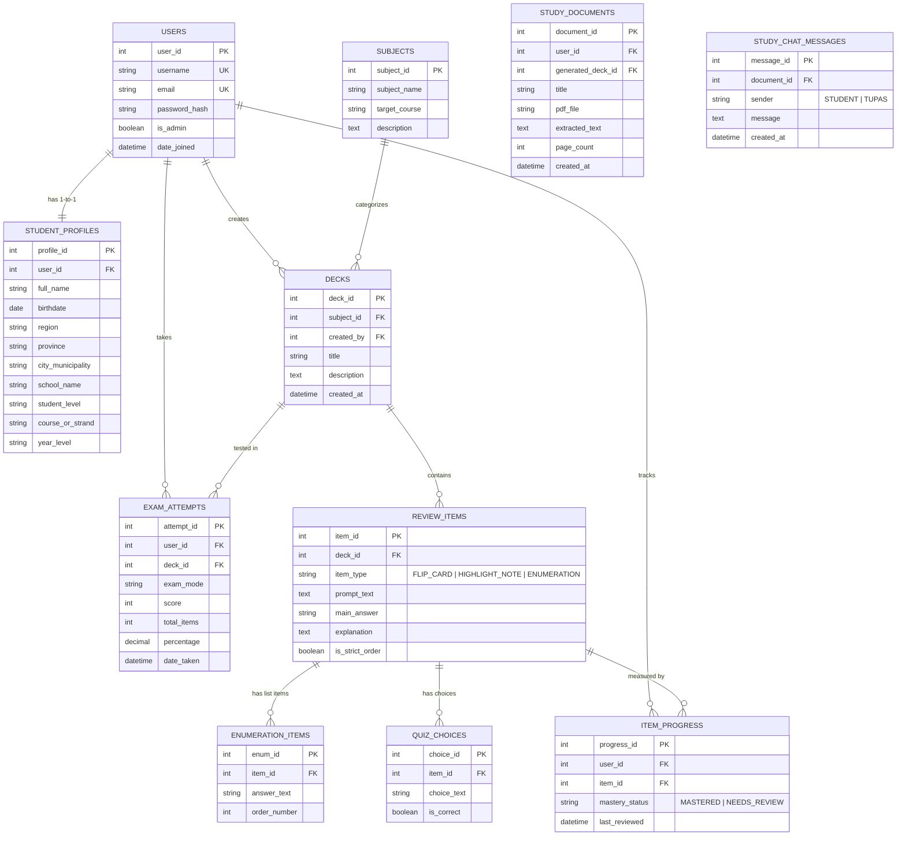
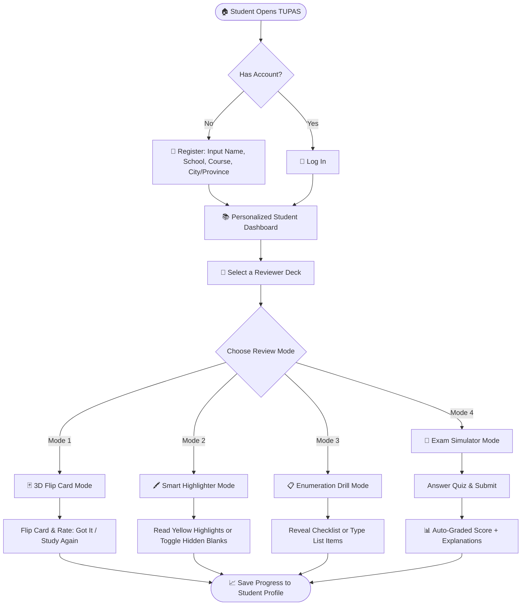

# 🎓 TUPAS: System & Database Schema Documentation

> **System Name:** **TUPAS** _(Pronounced "To Pass!")_  
> **Tagalog Acronym:** **T**alaan at **U**nawa **P**ara sa **A**ktibong **S**tudyante  
> **English Acronym:** **T**argeted **U**niversity **P**reparation and **A**cademic **S**tudy-System  
> **Full Academic Title:** _TUPAS: A Web-Based Multi-Modal Study and Exam Reviewer Platform with Flip Cards, Smart Highlighting, and Enumeration Drills_  
> **Framework:** Python / Django (MVT Architecture)

---

## 📑 Table of Contents

1. [Project Objectives, Scope, and Limitations](#1-project-objectives-scope-and-limitations)
2. [Database Overview & Normalization](#2-database-overview--normalization)
3. [Entity-Relationship Diagram (ERD)](#3-entity-relationship-diagram-erd)
4. [Complete 11-Table Data Dictionary (Database Schema)](#4-complete-11-table-data-dictionary-database-schema)
5. [Multi-Modal Storage Logic (Flip, Highlight, Enumeration)](#5-multi-modal-storage-logic-flip-highlight-enumeration)
6. [System Flowcharts & Diagrams (IPO, DFD, Use Case)](#6-system-flowcharts--diagrams-ipo-dfd-use-case)

---

## 1. Project Objectives, Scope, and Limitations

### General Objective

To design and develop **TUPAS (_Talaan at Unawa Para sa Aktibong Studyante_)**, a web-based multi-modal study and exam reviewer platform using the Django framework that helps students review through interactive Flip Cards, Smart Keyword Highlighting, Enumeration Drills, and Automated Practice Exams.

### Specific Objectives

1. **Student Profiling Module:** Record student demographics including **School/University, Course/Strand, Year Level, and Home Location (Region, Province, City/Municipality)** for personalized deck recommendations.
2. **Multi-Modal Study Engine:**
   - **🃏 3D Flip Cards:** Interactive front/back cards with self-assessment tracking (_"Got It"_ vs. _"Study Again"_).
   - **🖍️ Smart Highlighter Notes:** Paragraphs where `[[highlighted]]` keywords can be toggled into hidden tap-to-reveal blanks.
   - **📋 Enumeration Drills:** Interactive checklist and multi-input drills for ordered and unordered lists.
3. **Automated Exam Simulator:** Generate randomized quizzes (Multiple Choice, Identification, and Enumeration) with instant grading and answer explanations.
4. **Progress & Demographic Analytics:** Track mastered items, exam score history, and student distribution by school and location.

### Scope and Limitations

- **Scope:** Web-based and mobile-responsive; supports Student and Administrator roles; tracks school and city/province demographics; supports 4 review modes.
- **Limitations:** Requires internet/local network access; focuses on objective assessments (does not auto-grade open-ended essay paragraphs); location data is based on user profile selection rather than live GPS.

---

## 2. Database Overview & Normalization

The **TUPAS** database is designed for a **Relational Database Management System (RDBMS)** (SQLite for development / PostgreSQL or MySQL for production) and adheres to **Third Normal Form (3NF)**:

- **1NF:** All columns contain atomic values, and repeating groups (such as multiple enumeration answers or multiple-choice distractors) are separated into child tables (`enumeration_items` and `quiz_choices`).
- **2NF:** All non-key attributes are fully functionally dependent on each table's Primary Key.
- **3NF:** Transitive dependencies are eliminated by separating Authentication (`users`), Demographics (`student_profiles`), Categories (`subjects`), Decks (`decks`), and Review Items (`review_items`).

---

## 3. Entity-Relationship Diagram (ERD)

### 3.1 Mermaid ERD (Renders visually in VS Code / GitHub / Obsidian)



### 3.2 ASCII ERD (Text Diagram View)

```text
┌────────────────────┐         ┌────────────────────────┐
│       USERS        │ 1     1 │    STUDENT_PROFILES    │
├────────────────────┤─────────┼────────────────────────┤
│ PK user_id         │         │ PK profile_id          │
│    username        │         │ FK user_id             │
│    email           │         │    full_name           │
│    password_hash   │         │    birthdate           │
│    is_admin        │         │    region              │
│    date_joined     │         │    province            │
└─────────┬──────────┘         │    city_municipality   │
          │                    │    school_name         │
          │                    │    student_level       │
          │                    │    course_or_strand    │
          │                    │    year_level          │
          │                    └────────────────────────┘
          │                                         ┌────────────────────┐
          │                                         │      SUBJECTS      │
          │                                         ├────────────────────┤
          │                                         │ PK subject_id      │
          │                                         │    subject_name    │
          │                                         │    target_course   │
          │                                         └─────────┬──────────┘
          │                                                   │ 1
          │                                                   │ Many
          │                                         ┌─────────▼──────────┐
          │                                         │       DECKS        │
          │                                         ├────────────────────┤
          │                                         │ PK deck_id         │
          │                                         │ FK subject_id      │
          │                                         │    title           │
          │                                         │    description     │
          │                                         └─────────┬──────────┘
          │                                                   │ 1
          │                                                   │ Many
          │                                         ┌─────────▼──────────┐
          │                                         │    REVIEW_ITEMS    │
          │                                         ├────────────────────┤
          │                                         │ PK item_id         │
          │                                         │ FK deck_id         │
          │                                         │    item_type       │
          │                                         │    prompt_text     │
          │                                         │    main_answer     │
          │                                         │    explanation     │
          │                                         │    is_strict_order │
          │                                         └─────────┬──────────┘
          │                                                   │ 1
          ├──────────────────────────┐        ┌───────────────┼───────────────┐
          │                          │        │ Many          │ Many          │ Many
┌─────────▼──────────┐     ┌─────────▼────────▼─┐   ┌─────────▼──────────┐  ┌─▼──────────────────┐
│   EXAM_ATTEMPTS    │     │   ITEM_PROGRESS    │   │ ENUMERATION_ITEMS  │  │    QUIZ_CHOICES    │
├────────────────────┤     ├────────────────────┤   ├────────────────────┤  ├────────────────────┤
│ PK attempt_id      │     │ PK progress_id     │   │ PK enum_id         │  │ PK choice_id       │
│ FK user_id         │     │ FK user_id         │   │ FK item_id         │  │ FK item_id         │
│ FK deck_id         │     │ FK item_id         │   │    answer_text     │  │    choice_text     │
│    exam_mode       │     │    mastery_status  │   │    order_number    │  │    is_correct      │
│    score           │     │    last_reviewed   │   └────────────────────┘  └────────────────────┘
│    total_items     │     └────────────────────┘
│    percentage      │
│    date_taken      │
└────────────────────┘
```

---

## 4. Complete 11-Table Data Dictionary (Database Schema)

### Table 1: `users` (Authentication Table)

_Stores login credentials for students and administrators._

| Field Name    | Data Type    | Constraints                     | Description                                      |
| :------------ | :----------- | :------------------------------ | :----------------------------------------------- |
| `user_id`     | INT          | **PRIMARY KEY**, Auto-Increment | Unique identifier for each user                  |
| `username`    | VARCHAR(150) | UNIQUE, NOT NULL                | Student's login username                         |
| `email`       | VARCHAR(254) | UNIQUE, NOT NULL                | Student's email address                          |
| `password`    | VARCHAR(128) | NOT NULL                        | Encrypted/Hashed password                        |
| `is_admin`    | BOOLEAN      | DEFAULT `False`                 | `True` for Teachers/Admins, `False` for Students |
| `date_joined` | DATETIME     | NOT NULL                        | Timestamp of registration                        |

---

### Table 2: `student_profiles` (Student Demographics: Location & School)

_Connected 1-to-1 with `users`. Stores where the student lives and what school they attend._

| Field Name          | Data Type    | Constraints                               | Description                                        |
| :------------------ | :----------- | :---------------------------------------- | :------------------------------------------------- |
| `profile_id`        | INT          | **PRIMARY KEY**, Auto-Increment           | Unique identifier for the profile                  |
| `user_id`           | INT          | **FOREIGN KEY** (`users.user_id`), UNIQUE | 1-to-1 link to the user account                    |
| `full_name`         | VARCHAR(200) | NOT NULL                                  | Student's full name                                |
| `birthdate`         | DATE         | NULL                                      | Student's date of birth                            |
| `region`            | VARCHAR(100) | NOT NULL                                  | e.g., `NCR`, `Region IV-A`, `Region VII`           |
| `province`          | VARCHAR(100) | NOT NULL                                  | e.g., `Cavite`, `Laguna`, `Cebu`                   |
| `city_municipality` | VARCHAR(100) | NOT NULL                                  | e.g., `Quezon City`, `Dasmariñas`                  |
| `school_name`       | VARCHAR(200) | NOT NULL                                  | Name of High School, College, or University        |
| `student_level`     | VARCHAR(50)  | NOT NULL                                  | `Junior HS`, `Senior HS`, `College`, `Board Taker` |
| `course_or_strand`  | VARCHAR(150) | NOT NULL                                  | e.g., `STEM`, `ABM`, `BS Nursing`, `BSIT`          |
| `year_level`        | VARCHAR(50)  | NOT NULL                                  | e.g., `Grade 12`, `1st Year`, `4th Year`           |

---

### Table 3: `subjects` (Course Categories)

_Categorizes reviewer decks by academic subject or major._

| Field Name      | Data Type    | Constraints                     | Description                                   |
| :-------------- | :----------- | :------------------------------ | :-------------------------------------------- |
| `subject_id`    | INT          | **PRIMARY KEY**, Auto-Increment | Unique ID for the subject                     |
| `subject_name`  | VARCHAR(150) | NOT NULL                        | e.g., `General Anatomy`, `Philippine History` |
| `target_course` | VARCHAR(150) | NULL                            | Matches `course_or_strand` to recommend decks |
| `description`   | TEXT         | NULL                            | Brief overview of the subject                 |

---

### Table 4: `decks` (Reviewer Folders / Sets)

_A collection of review items grouped under a specific topic or chapter._

| Field Name    | Data Type    | Constraints                             | Description                                   |
| :------------ | :----------- | :-------------------------------------- | :-------------------------------------------- |
| `deck_id`     | INT          | **PRIMARY KEY**, Auto-Increment         | Unique ID for the reviewer deck               |
| `subject_id`  | INT          | **FOREIGN KEY** (`subjects.subject_id`) | Links deck to a subject                       |
| `title`       | VARCHAR(200) | NOT NULL                                | e.g., `"Prelim Reviewer: The Nervous System"` |
| `description` | TEXT         | NULL                                    | Summary of topics covered in this deck        |
| `created_by`  | INT          | **FOREIGN KEY** (`users.user_id`)       | Admin or User who created the deck            |
| `created_at`  | DATETIME     | NOT NULL                                | Date the deck was created                     |

---

### Table 5: `review_items` (Core Multi-Type Review Table)

_Each row can function as a Flip Card, a Smart Highlighted Note, or an Enumeration prompt._

| Field Name        | Data Type    | Constraints                       | Description                                                                                                                                                         |
| :---------------- | :----------- | :-------------------------------- | :------------------------------------------------------------------------------------------------------------------------------------------------------------------ |
| `item_id`         | INT          | **PRIMARY KEY**, Auto-Increment   | Unique ID for the review item                                                                                                                                       |
| `deck_id`         | INT          | **FOREIGN KEY** (`decks.deck_id`) | Which deck this item belongs to                                                                                                                                     |
| `item_type`       | VARCHAR(30)  | NOT NULL                          | `FLIP_CARD`, `HIGHLIGHT_NOTE`, or `ENUMERATION`                                                                                                                     |
| `prompt_text`     | TEXT         | NOT NULL                          | • **Flip Card:** Front question/term<br>• **Highlight Note:** Paragraph containing `[[keywords]]`<br>• **Enumeration:** List prompt (e.g., _"4 Stages of Mitosis"_) |
| `main_answer`     | VARCHAR(255) | NULL                              | • **Flip Card / Identification:** Correct answer on the back of the card.<br>• _Nullable for Enumeration & Highlight Notes_                                         |
| `explanation`     | TEXT         | NULL                              | Study explanation shown after flipping or submitting a quiz                                                                                                         |
| `is_strict_order` | BOOLEAN      | DEFAULT `False`                   | **For Enumeration only:** `True` if answers must be in exact step order                                                                                             |

---

### Table 6: `enumeration_items` (Enumeration Answers List)

_Stores the list of correct answers for any `review_item` where `item_type = 'ENUMERATION'`._

| Field Name     | Data Type    | Constraints                              | Description                               |
| :------------- | :----------- | :--------------------------------------- | :---------------------------------------- |
| `enum_id`      | INT          | **PRIMARY KEY**, Auto-Increment          | Unique ID for the enumeration item        |
| `item_id`      | INT          | **FOREIGN KEY** (`review_items.item_id`) | Links to the parent Enumeration question  |
| `answer_text`  | VARCHAR(255) | NOT NULL                                 | One item in the list (e.g., `"Prophase"`) |
| `order_number` | INT          | NOT NULL                                 | Sequence position (`1`, `2`, `3`, `4`...) |

---

### Table 7: `quiz_choices` (Multiple Choice Options)

_Stores multiple-choice options when a review item is used in **Exam Simulator Mode**._

| Field Name    | Data Type    | Constraints                              | Description                                           |
| :------------ | :----------- | :--------------------------------------- | :---------------------------------------------------- |
| `choice_id`   | INT          | **PRIMARY KEY**, Auto-Increment          | Unique ID for the choice                              |
| `item_id`     | INT          | **FOREIGN KEY** (`review_items.item_id`) | Links to the question                                 |
| `choice_text` | VARCHAR(255) | NOT NULL                                 | Option text (Choice A, B, C, or D)                    |
| `is_correct`  | BOOLEAN      | DEFAULT `False`                          | `True` if correct answer, `False` if wrong distractor |

---

### Table 8: `item_progress` (Student Mastery Tracker)

_Tracks whether a student marked an item as "Got It" or "Study Again" during review._

| Field Name       | Data Type   | Constraints                              | Description                                             |
| :--------------- | :---------- | :--------------------------------------- | :------------------------------------------------------ |
| `progress_id`    | INT         | **PRIMARY KEY**, Auto-Increment          | Unique ID                                               |
| `user_id`        | INT         | **FOREIGN KEY** (`users.user_id`)        | The student studying                                    |
| `item_id`        | INT         | **FOREIGN KEY** (`review_items.item_id`) | The item being studied                                  |
| `mastery_status` | VARCHAR(20) | NOT NULL                                 | `MASTERED` ("Got It") or `NEEDS_REVIEW` ("Study Again") |
| `last_reviewed`  | DATETIME    | NOT NULL                                 | Timestamp of last review interaction                    |

---

### Table 9: `exam_attempts` (Quiz Scores & Analytics)

_Records every practice exam a student completes._

| Field Name    | Data Type    | Constraints                       | Description                                                    |
| :------------ | :----------- | :-------------------------------- | :------------------------------------------------------------- |
| `attempt_id`  | INT          | **PRIMARY KEY**, Auto-Increment   | Unique ID for the exam session                                 |
| `user_id`     | INT          | **FOREIGN KEY** (`users.user_id`) | Student who took the exam                                      |
| `deck_id`     | INT          | **FOREIGN KEY** (`decks.deck_id`) | Deck that was tested                                           |
| `exam_mode`   | VARCHAR(50)  | NOT NULL                          | `MULTIPLE_CHOICE`, `IDENTIFICATION`, `ENUMERATION`, or `MIXED` |
| `score`       | INT          | NOT NULL                          | Points earned by the student                                   |
| `total_items` | INT          | NOT NULL                          | Total possible points                                          |
| `percentage`  | DECIMAL(5,2) | NOT NULL                          | Calculated grade (e.g., `85.50`)                               |
| `date_taken`  | DATETIME     | NOT NULL                          | Timestamp when the exam was submitted                          |

_Exam papers are shuffled per attempt with a deterministic seed, and each rendered form carries a one-time attempt token so a refreshed POST never stores a duplicate attempt._

---

### Table 10: `study_documents` (TUPAS Study Buddy Handouts)

_Stores one uploaded PDF or pasted note set per row, owned by the student who created it._

| Field Name       | Data Type    | Constraints                                | Description                                            |
| :--------------- | :----------- | :----------------------------------------- | :----------------------------------------------------- |
| `document_id`    | INT          | **PRIMARY KEY**, Auto-Increment            | Unique ID for the handout                              |
| `user_id`        | INT          | **FOREIGN KEY** (`users.user_id`), NOT NULL | Student who owns the handout                           |
| `title`          | VARCHAR(200) | NOT NULL                                   | Handout or topic title                                 |
| `pdf_file`       | VARCHAR(100) | NULL                                       | Uploaded PDF/TXT path under `media/study_pdfs/`         |
| `extracted_text` | TEXT         | NOT NULL (may be blank)                    | Text sent to the tutor and deck generator              |
| `page_count`     | INT          | DEFAULT `1`                                | Pages detected during extraction                       |
| `generated_deck_id` | INT       | **FOREIGN KEY** (`decks.deck_id`), NULL    | Deck produced by "Convert to Reviewer Deck"            |
| `created_at`     | DATETIME     | NOT NULL                                   | Upload timestamp                                       |

---

### Table 11: `study_chat_messages` (Study Buddy Conversation)

_Stores the ordered chat transcript between the student and the TUPAS tutor for one handout._

| Field Name   | Data Type   | Constraints                                  | Description                          |
| :----------- | :---------- | :------------------------------------------- | :----------------------------------- |
| `message_id` | INT         | **PRIMARY KEY**, Auto-Increment              | Unique ID for the message            |
| `document_id`| INT         | **FOREIGN KEY** (`study_documents.document_id`) | Handout the conversation belongs to |
| `sender`     | VARCHAR(20) | NOT NULL                                     | `STUDENT` or `TUPAS`                 |
| `message`    | TEXT        | NOT NULL                                     | Message body                         |
| `created_at` | DATETIME    | NOT NULL                                     | Message timestamp                    |

---

### 4.1 Implementation Notes (Current Build)

- **Schema count:** 11 logical tables — the built-in `auth_user` table, the 8 core reviewer tables (`student_profiles` … `exam_attempts`), and the 2 Study Buddy tables (`study_documents`, `study_chat_messages`).
- **Configuration:** `config/settings.py` loads `BASE_DIR / '.env'` at startup (existing shell variables take precedence), so `SECRET_KEY`, `DJANGO_DEBUG`, and `ALLOWED_HOSTS` can be supplied without editing source.
- **Default AI model:** Google Gemini defaults to `gemini-2.5-flash`; `GEMINI_MODEL` overrides it. Groq and OpenRouter defaults are listed in `TUPAS_DOCUMENTATION.md` §10.2.
- **Randomized exams:** question order and multiple-choice option order are shuffled per attempt with a deterministic `exam_seed`, and each rendered form carries a one-time `attempt_token` so refreshing a submitted exam cannot insert a duplicate `exam_attempts` row.
- **Study Buddy flow:** `study_documents.generated_deck_id` links a handout to the deck produced by the one-click generator; each chat turn is stored in `study_chat_messages` and every view is scoped to the document owner.

---

## 5. Multi-Modal Storage Logic (Flip, Highlight, Enumeration)

| Mode                     | `item_type` Value | How It Is Stored in the Database                                                                                        | How TUPAS Renders It to the Student                                                                                                                  |
| :----------------------- | :---------------- | :---------------------------------------------------------------------------------------------------------------------- | :--------------------------------------------------------------------------------------------------------------------------------------------------- |
| **🃏 Flip Card**         | `FLIP_CARD`       | `prompt_text`: Front question<br>`main_answer`: Back answer<br>`explanation`: Additional notes                          | 3D card that flips on click/spacebar, followed by **Got It** / **Study Again** buttons.                                                              |
| **🖍️ Smart Highlighter** | `HIGHLIGHT_NOTE`  | `prompt_text`: Paragraph with double brackets around key terms, e.g., `"The [[mitochondria]] produces [[ATP]] energy."` | **Read Mode:** Renders `[[word]]` as yellow `<mark>` highlights.<br>**Blind Mode:** Hides `[[word]]` inside clickable `[ ❓ Tap to Reveal ]` blanks. |
| **📋 Enumeration**       | `ENUMERATION`     | `prompt_text`: List prompt (e.g., _"3 Branches of Gov"_).<br>Answers stored as rows in `enumeration_items`.             | **Study Mode:** Tap-to-reveal numbered slots.<br>**Quiz Mode:** Renders `N` text boxes and checks order if `is_strict_order = True`.                 |

---

## 6. System Flowcharts & Diagrams (IPO, DFD, Use Case)

### 6.1 Student Journey Flowchart (Mermaid)



### 6.2 Conceptual Framework (IPO Model)

```text
┌───────────────────────────┐      ┌───────────────────────────┐      ┌───────────────────────────┐
│           INPUT           │      │          PROCESS          │      │          OUTPUT           │
├───────────────────────────┤      ├───────────────────────────┤      ├───────────────────────────┤
│ • Student Credentials     │      │ • User Authentication &   │      │                           │
│ • School & Course Info    │      │   Profile Categorization  │      │      TUPAS: Web-Based     │
│ • Home Location (City/    │      │ • Deck & Review Item      │      │    Multi-Modal Study &    │
│   Province/Region)        │ ───► │   Management (CRUD)       │ ───► │  Exam Reviewer Platform   │
│ • Reviewer Decks & Items  │      │ • Multi-Modal Rendering   │      │                           │
│   - Flip Cards            │      │   (Flip, Highlight, Enum) │      │ • Personalized Dashboard  │
│   - [[Highlighted]] Notes │      │ • Automated Quiz Grading  │      │ • Interactive Reviewers   │
│   - Enumeration Lists     │      │   & Score Calculation     │      │ • Instant Exam Results    │
│ • Student Quiz Answers    │      │ • Progress & Demographic  │      │ • Student Mastery Reports │
│                           │      │   Analytics Generation    │      │                           │
└───────────────────────────┘      └───────────────────────────┘      └───────────────────────────┘
              ▲                                                                     │
              └────────────────────────── FEEDBACK ─────────────────────────────────┘
```

### 6.3 Context Diagram (DFD Level 0)

```text
┌───────────────────┐                                                 ┌───────────────────┐
│                   │ ── 1. Registration, School & Location Info ───► │                   │
│                   │ ── 2. Selected Study Mode (Flip/Highlight/Enum)►│                   │
│                   │ ── 3. Submitted Exam Answers ─────────────────► │                   │
│                   │                                                 │     (Process 0)   │
│      STUDENT      │                                                 │       TUPAS       │
│  (External Entity)│ ◄─ 4. Personalized Decks & Study Interface ──── │  REVIEWER SYSTEM  │
│                   │ ◄─ 5. Auto-Graded Exam Score & Explanations ─── │                   │
│                   │ ◄─ 6. Mastery Progress & Leaderboard Rank ───── │                   │
└───────────────────┘                                                 └─────────▲─────────┘
                                                                                │ │
                                           1. Subjects, Decks & Review Items ───┘ │
                                              (Cards, Highlights, Enumerations)   │
                                                                                  │
                                           2. Student Demographic & Score Reports ┘
                                                                                │ ▼
                                                                      ┌───────────────────┐
                                                                      │   ADMINISTRATOR   │
                                                                      │ (External Entity) │
                                                                      └───────────────────┘
```
